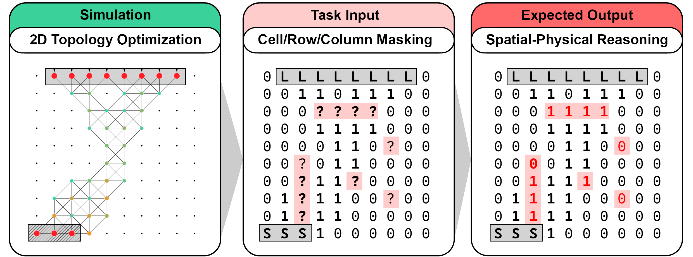

# 🧠 **SPhyR**

_A Spatial Physical Reasoning Benchmark_



## 🤗 SPhyR on HuggingFace

You can also explore or download the dataset directly from Hugging Face:

🔗 [SPhyR on Hugging Face](https://huggingface.co/datasets/philippds/SPhyR)

---

## 🌐 SPhyR as an OpenEnv Environment

SPhyR is packaged as an [OpenEnv](https://github.com/meta-pytorch/OpenEnv)
environment in [`envs/sphyr_env/`](envs/sphyr_env/), so an agent can be
evaluated or trained against it through the standard `reset` / `step`
interface instead of through bespoke benchmark code.

An episode is a single step: the environment hands out a masked structural
grid, the agent submits the completed grid, and the environment scores it by
simulating it (see [Dynamic Evaluation](#-dynamic-evaluation-topology-optimization-in-the-loop)).

```python
from sphyr_env import SPhyREnv, SPhyRAction

env = SPhyREnv(base_url="http://localhost:8000")

result = env.reset(subject="10_random_cell_easy")
print(result.observation.grid)     # the masked grid, with 'V' cells to fill
print(result.observation.prompt)   # the same task, phrased for a language model

result = env.step(SPhyRAction(grid=completed_grid_text))
print(result.reward)                                 # topology score, 0..1
print(result.observation.metrics["load_carrying"])   # did it stand up?
```

Or in-process, with no server:

```python
from sphyr_env.server.sphyr_environment import SPhyREnvironment

env = SPhyREnvironment()
observation = env.reset(subject="full_hard")
scored = env.step(SPhyRAction(grid=completed_grid_text))
```

Serve it over HTTP, or build the container:

```bash
cd envs/sphyr_env && uvicorn server.app:app --port 8000

docker build -f envs/sphyr_env/server/Dockerfile -t sphyr-env:latest .
```

The environment is the only thing that knows how a task is built or how an
answer is scored, so a language model run through
[`src/sphyr/run_eval.py`](src/sphyr/run_eval.py) and an RL agent trained
against the served environment are measured identically. See
[`envs/sphyr_env/README.md`](envs/sphyr_env/README.md) for the full `reset()`
parameter set.

---

## 🏃 Running the Benchmark

Every model is reached through [OpenRouter](https://openrouter.ai), so the
benchmark needs one key and one endpoint rather than an SDK per vendor. Put
`OPENROUTER_API_KEY` in `.env` (see `.env.example`), then:

```bash
# The main experiment: every model, all 16 subjects
python -m sphyr.run_eval main

# A single model
python -m sphyr.run_eval main --models claude-opus-4-20250514

# Any other OpenRouter model, named by its id
python -m sphyr.run_eval main --models anthropic/claude-sonnet-4.5

# The ablations reported in the paper
python -m sphyr.run_eval rotations
python -m sphyr.run_eval few-shot --few-shot-count 3
python -m sphyr.run_eval physics-enhanced

# Re-score everything already stored, without spending an API call
python -m sphyr.run_eval rescore

# Run against a served environment instead of an in-process one
python -m sphyr.run_eval main --base-url http://localhost:8000
```

Results are written per model and subject to `results/<model>/<subject>_results.json`,
and runs resume from whatever is already stored there.

### Options worth knowing

```bash
# New evaluations with explicit force directions (see "Dataset versions")
python -m sphyr.run_eval main --dataset-version v2-force
python -m sphyr.run_eval main --dataset-version v2-20-force --sample-count 300

# Measure a new model on exactly the samples a stored run was scored on
python -m sphyr.run_eval main --models anthropic/claude-sonnet-4.5 \
    --replay-from claude-opus-4-20250514

# Keep several calls in flight; only the model calls are parallel
python -m sphyr.run_eval main --concurrency 8

# A local model served by Ollama, at its OpenAI-compatible endpoint
python -m sphyr.run_eval main --models ollama/qwen3:8b

# Answer as a list of solid cells instead of a grid (see "Answer formats")
python -m sphyr.run_eval main --models anthropic/claude-opus-5 --dataset-version v2-20 \
    --replay-from anthropic_claude-opus-5_v2-20 --prompt-style sparse

# Repeat a run under its own name instead of resuming the stored one
python -m sphyr.run_eval main --models google/gemini-3.8-flash --dataset-version v2-20 \
    --replay-from anthropic_claude-opus-5_v2-20 --name-suffix _rerun

# Baselines that answer without a model, to calibrate absolute scores
python -m sphyr.run_eval main --models baseline-solid baseline-empty \
    baseline-random baseline-retrieval
```

`--replay-from` matters more than it looks. The published sample sets are **not**
reproducible by re-deriving them from the dataset: every subject that masks a
random region had its masks drawn once, and regenerating the dataset re-rolls
them. The samples that were actually evaluated survive in the results files,
which store the prompt and the answer for every completion, and `--replay-from`
serves exactly those. Without it a new run draws its own samples and its numbers
are not comparable with the published columns.

### Dataset versions

| `--dataset-version` | Grid | Samples | Use it for |
| --- | --- | --- | --- |
| `v1` (default) | 10×10 | 1296 | the version the paper's results were produced on |
| `v2` | 10×10 | 300 | replay the paper's historical fixed-direction tasks |
| `v2-20` | 20×20 | 300 | replay the paper's historical fixed-direction tasks |
| `v2-force` | 10×10 | 300 | new work, explicit generation force in prompt and scoring |
| `v2-20-force` | 20×20 | 300 | new work, explicit generation force in prompt and scoring |

v1 was generated by sweeping load and support positions one cell at a time, so
of its 1295 distinct boundary conditions, 1294 have another one a single cell
away and adjacent load cases usually share an optimal structure. v2 changes only
the sampling — loads and supports on any edge, eight generation load directions, and
rejection sampling that holds every pair of samples at least 6 boundary cells
and 8 structure cells apart.

Historical `v2` and `v2-20` files omitted the generated force vectors. The
paper's existing single-step, sparse and feedback results all use the default
downward force, left implicit in their prompts. Their stored layouts supply
visible material, reconstruction targets and budgets, and need not be optimal
for that force. The scoring optimizer uses the same evaluated force as the
submitted design. These results do not test explicit force-direction changes.

The separately named `*-force` versions retain those vectors and state them in
every prompt, including sparse, few-shot and feedback prompts. Rotation turns
both grid and force; results save the displayed force for replay and rescoring.
Both corrected sets were recovered with generator seed 0 and checked by
re-solving all 600 cases: binary and rounded density answers matched exactly.
Each directory contains a provenance manifest with hashes of its source files.
No model results on these corrected versions are reported, and historical
datasets and model answers remain unchanged. Comparing against their old
scores requires new model calls; relabeling old replies is not a valid rerun.

### Answer formats

The default prompt asks for the completed grid, and a reply that is not a grid
of the right shape scores zero. At 20×20 that makes emitting several hundred
cells in an exact shape part of what is measured: a model that runs out of
output budget mid-row, or miscounts a row, loses the sample whatever it had
reasoned about the structure.

`--prompt-style sparse` serves the same task without the grid in the answer.
The prompt lists the masked cells by row (`row 3: 0-4, 9`) and asks for only the
masked cells that should carry material, one per line as `row,column` (binary
subjects), `row,column,value` (density subjects) or `NONE`. Every masked cell
not listed is empty and every visible cell keeps its value, so no answer can be
misshapen. An entry that names an unmasked or out-of-range cell is dropped and
counted (`sparse_rejected_entries` in the record) rather than voiding the
answer; a reply with no entry at all and no `NONE` scores as unreadable, like a
grid reply with no grid in it.

Results land in their own directory, `results/<model>_sparse[_<version>]/`,
next to the grid run; `--replay-from` the grid run so both formats answer the
same samples, then compare them with `analyze_results formats` (see "Analyses
behind the paper").

### Feedback rounds

The environment is single-step by default. With `feedback_rounds` set, a
submission is simulated and the model is shown how the structure behaved —
whether it stood, its stiffness against the best design at that budget, its
material use — and asked to revise. The feedback is physical and never says
which cells are wrong.

```python
from sphyr_env.server.sphyr_environment import SPhyREnvironment

env = SPhyREnvironment(feedback_rounds=3)
```

The experiment behind the paper's feedback section runs each sample twice over:
once with the simulator's report between attempts and once re-posing the same
prompt with nothing added, so that best-of-several is controlled for and only
the gap between the two arms is credited to the feedback:

```bash
# Revision arm: answer, be simulated, revise, for three further attempts
python -m sphyr.run_feedback --models ollama/qwen3:8b --subject full_easy \
    --dataset-version v2 --samples 50 --rounds 3

# Control arm: the same four attempts with the prompt simply re-posed
python -m sphyr.run_feedback --models ollama/qwen3:8b --subject full_easy \
    --dataset-version v2 --samples 50 --rounds 3 --no-feedback
```

Each attempt is scored on its own and stored under
`results/<model>_feedback_<version>/` and `results/<model>_resample_<version>/`.

The models the paper reported are mapped to their OpenRouter ids in
[`src/sphyr/policies.py`](src/sphyr/policies.py), keyed by the name their
results are stored under so a fresh run stays comparable with the published
numbers. Three of them — Gemini 1.5 Pro, Claude 3.7 Sonnet and Perplexity Sonar
Reasoning — are no longer served by OpenRouter: their stored results are still
read, plotted and re-scored, but they cannot be run again and are marked as
such rather than failing mid-experiment.

---

## 🔁 How to Re-Generate the Dataset

**SPhyR-v2 regenerates from source with no external tools:**

```python
from sphyr.dataset_creation.generate_v2 import generate_samples, write_subjects

samples = generate_samples(300, grid=20)          # ~4.4s per sample at 20x20
write_subjects(samples, "new_datasets_v2_20_force") # writes 16 files with load_direction
```

Ground truth comes from the project's own SIMP optimizer — the one that also
computes the structural metrics — so v2 needs neither Rhinoceros nor Grasshopper.
Sampling parameters (separation thresholds, load directions, volume fraction)
are constants at the top of
[`generate_v2.py`](src/sphyr/dataset_creation/generate_v2.py).

**SPhyR-v1 needs the original toolchain.** Its ground truth was produced with
Millipede inside Grasshopper, so recreating it from scratch follows the steps
below.

### 🛠️ Step 1: Installation

1. **Install uv**  
   [uv](https://docs.astral.sh/uv/) manages the Python version, the virtual
   environment and the dependencies.

   ```bash
   # macOS / Linux
   curl -LsSf https://astral.sh/uv/install.sh | sh

   # Windows
   powershell -c "irm https://astral.sh/uv/install.ps1 | iex"
   ```

2. **Sync the Project**  

   ```bash
   uv sync
   ```

   This creates `.venv`, installs everything from `uv.lock`, and installs both
   packages: `sphyr` (tasks, physics, metrics) from `src/` and the OpenEnv
   environment `sphyr_env` from `envs/`.

   Commands are then run with `uv run`, e.g. `uv run pytest`, or inside the
   activated environment (`source .venv/bin/activate`,
   `.venv\Scripts\activate` on Windows). The rest of this README writes the
   bare command; prefix it with `uv run` if you have not activated `.venv`.

### 🦏 Step 2: Rhinoceros 8.0 & Grasshopper Setup

1. **Download Rhinoceros 8.0**  
   Rhino includes the **Grasshopper** visual programming environment.  
   📥 [Download here](https://www.rhino3d.com/)

2. **Install Millipede Plugin**  
   Move the **Millipede plugin** to Grasshopper's special components folder:

   ```
   src/sphyr/dataset_creation/topology_optimization_data/2D/rhino_grasshopper/libraries/millipede
   ```

   You can access the special folder in Grasshopper via:  
   `File` > `Special Folders` > `Components Folder`

3. **Open the Rhino & Grasshopper Files**

   - Rhino File:  
     `src/sphyr/dataset_creation/topology_optimization_data/2D/rhino_grasshopper/SPhyR_2D.3dm`
   - Grasshopper Script:  
     `src/sphyr/dataset_creation/topology_optimization_data/2D/rhino_grasshopper/SPhyR_2D.gh`

   ✅ Once opened, run the Grasshopper script by toggling the boolean on the **top-left of the canvas**.

   💡 **Tip**: If you'd rather skip this step, precomputed results are available:

   - Raw Data: `src/sphyr/dataset_creation/topology_optimization_data/2D/raw_data`
   - Plots/Frames: `src/sphyr/dataset_creation/topology_optimization_data/2D/frames`

### 📦 Step 3: Convert to JSON (HuggingFace Dataset Format)

Run the following Python script to convert raw simulation output to a format suitable for evaluation on HuggingFace:

```bash
python src/sphyr/dataset_creation/raw_data_2D_to_huggingface_datasets.py
```

This script processes the `.csv` simulation outputs into structured `.json` entries.

---

## 🧮 Dynamic Evaluation (Topology Optimization in the Loop)

Comparing a completion to the reference answer cell by cell asks the wrong
question: a structure that routes the load differently but just as efficiently
is marked wrong, while one that matches almost everywhere but severs the load
path is marked nearly right. SPhyR therefore also evaluates completions
**dynamically** — by simulating them and re-running a real topology optimizer.

### How a completion is scored

Only masked (`V`) cells are design variables. A full-grid reply is checked for
shape and allowed values first; then the original visible cells, including all
loads and supports, are restored before reconstruction, graph and simulation
metrics are computed. This gives the prediction and reference optimizer the
same permitted design region. Sparse replies follow the same rule. Unreadable
or misshapen replies still score zero.

The original `completion` is retained. `scored_grid` records the reconstructed
design, and `visible_cell_changes`, `visible_numeric_cell_changes`,
`visible_boundary_cell_changes` and `visible_cells_preserved` measure copying
errors separately. New results carry `scoring_policy: "masked-only-v1"`.

To migrate stored answers without new model calls:

```bash
python -m sphyr.rescore --workers 8
```

The command recomputes every metric and its aggregate, backs up the original
files under `.rescore/`, and reuses the existing optimizer references for the
unchanged tasks. `--rebuild-references` reruns those optimizations as well.
`--runs RUN_NAME --limit-records 5 --dry-run` times a subset without writing.
Stored feedback trajectories are rescored as the originally sampled attempts;
the command does not regenerate the feedback or request new model responses.

1. **Rebuild the load case.** The `L`, `S` and density cells of the sample are
   turned into a plane-stress finite element model: a unit load spread over the
   load cells, the support cells clamped, one bilinear (Q4) element per grid
   cell, and stiffness interpolated from density with the SIMP law
   `E(ρ) = E_min + ρ^p (E_0 − E_min)`.
2. **Simulate the completion.** Solving `K u = f` gives its **compliance**
   (the work done by the load — the inverse of stiffness). A completion whose
   load path is broken shows up as a compliance orders of magnitude larger than
   a solid grid, so `load_carrying` is a physical fact, not a graph heuristic.
3. **Re-optimize the same hole.** A SIMP optimizer (density filter, optimality
   criteria update, penalization continuation, discrete swap polish) is re-run
   on **exactly the masked cells**, with the rest of the sample pinned and with
   the reference material budget. The search is seeded with the dataset answer,
   so the resulting optimum is by construction at least as good as it.
4. **Score.** How close the completion gets to that optimum, discounted by any
   material it spent beyond the reference budget.

### Metrics

| Metric | Meaning |
| --- | --- |
| `topology_score` | **Headline.** `structural_efficiency × material_efficiency` |
| `structural_efficiency` | `optimal_compliance / compliance`, clipped to [0, 1] |
| `material_efficiency` | `min(1, reference_volume / used_volume)` |
| `load_carrying` | Does the load actually reach the supports? |
| `compliance` | Raw simulated compliance (lower is better) |
| `optimal_compliance` | Compliance of the re-optimized structure |
| `compliance_efficiency_vs_ground_truth` | Stiffness relative to the dataset answer |
| `volume_ratio` | Material used, relative to the dataset answer |
| `design_efficiency` | Optional: optimum re-run at the completion's *own* budget |

Both halves of the headline score are needed: stiffness alone is maximised by
filling the grid solid, thrift alone by building nothing. Filling everything
solid scores a perfect `structural_efficiency` but is discounted to roughly the
reference volume fraction; an empty grid scores zero.

### Running it

```bash
# Add the structural metrics to the stored benchmark results
python -m sphyr.evaluate_dynamic rescore --workers 8

# Check that the metric ranks known-good and known-bad completions correctly
python -m sphyr.evaluate_dynamic validate --subject full_easy --samples 20
```

`validate` scores the dataset answer against deliberately degraded and
degenerate completions and reports how often the reference optimizer was beaten
by the answer it is meant to bound (it should be zero):

```
completion         topo score  stiffness  material   vs GT  volume  carrying
----------------------------------------------------------------------------
dataset answer          0.933      0.933     1.000   1.000   0.285     1.000
2 cells flipped         0.844      0.889     0.952   0.948   0.298     1.000
10 cells flipped        0.295      0.350     0.555   0.375   0.339     0.650
filled solid            0.317      1.000     0.317   1.000   0.895     1.000
left empty              0.000      0.000     0.000   0.000   0.096     0.000

Reference optimiser beaten by the dataset answer on 0/20 samples.
```

The dataset answer does not score 1.0: the optimizer usually finds a slightly
stiffer structure for the same material, which is exactly the headroom a model
is being measured against.

To score completions from your own code:

```python
from sphyr.metrics.structural import get_structural_metrics

metrics = get_structural_metrics(
    output_grid=completion_grid,  # list[list[str]]
    gt_grid=sample["ground_truth"],
    input_grid=sample["input_grid"],
)
print(metrics.topology_score, metrics.load_carrying)
```

The physics engine is standalone and reusable:
`src/sphyr/physics/fea.py` (finite elements),
`src/sphyr/physics/simp.py` (topology optimization),
`src/sphyr/physics/boundary_conditions.py` (grid → load case),
`src/sphyr/physics/analysis.py` (structural response).

---

## 🔍 Analyses Behind the Paper

The statistics the paper quotes beyond its result tables are computed from the
stored completions by [`src/sphyr/analyze_results.py`](src/sphyr/analyze_results.py).
None of the first four calls a model or re-runs a simulation; they read the
metrics stored with every record.

```bash
# The abstract's numbers: valid completions that carry their load while differing
# from the reference, and where cell-graph connectivity and compliance disagree
python -m sphyr.analyze_results headline

# Completions as good as the reference design on both factors, yet not the reference
python -m sphyr.analyze_results alternatives

# Why unreadable completions are unreadable: no grid, cut off, extra rows, wrong widths
python -m sphyr.analyze_results invalid --runs google_gemini-3.8-flash_v2-20

# Grid against sparse answers on the samples both runs share; --latex prints table rows
python -m sphyr.analyze_results formats --runs anthropic_claude-opus-5_v2-20 \
    google_gemini-3.8-flash_rerun_v2-20:google_gemini-3.8-flash_sparse_v2-20

# Model-free: drive the optimizer into other local optima and count the structurally
# different designs the verifier rates as highly as the reference (runs the solver)
python -m sphyr.analyze_results optima --dataset-version v2 --samples 30
```

`headline` and `alternatives` default to the v1 runs the paper's statistics were
first computed over, so their numbers keep meaning what the paper says; pass
`--runs` to compute them over other result directories. `formats` pairs each
grid run with its `_sparse` counterpart automatically, or takes `GRID:SPARSE`
to pair two directories explicitly, as above for a rerun.

---

## 📊 Additional Information

### 🧪 Results Overview

Benchmarks for 100 samples are available for the following models:

- **Claude 3.7 Sonnet** *(retired from OpenRouter)*
- **Claude Opus 4**
- **DeepSeek-R1**
- **Gemini 1.5 Pro** *(retired from OpenRouter)*
- **Gemini 2.5 Pro**
- **GPT-3.5 Turbo**
- **GPT-4.1**
- **GPT-4o**
- **Perplexity Sonar**
- **Perplexity Sonar Reasoning** *(retired from OpenRouter)*

📁 You can find these results inside the `results` directory.

### 3D Topology Optimization Data

We have included a preliminary sub-set of 3D data and corresponding plots, but we plan to release a full set in the future. 3D Data can be found here: `src/sphyr/dataset_creation/topology_optimization_data/3D`.

---

## Citation

**BibTeX:**

```pyhton
@misc{siedler2025sphyr,
  title        = {SPhyR: Spatial-Physical Reasoning Benchmark on Material Distribution},
  author       = {Philipp D. Siedler},
  year         = {2025},
  eprint       = {2505.16048},
  archivePrefix= {arXiv},
  primaryClass = {cs.AI},
  doi          = {10.48550/arXiv.2505.16048},
  url          = {https://arxiv.org/abs/2505.16048}
}
```

**APA:**

```python
Siedler, P. D. (2025). SPhyR: Spatial-Physical Reasoning Benchmark on Material Distribution. arXiv. https://doi.org/10.48550/arXiv.2505.16048
```
